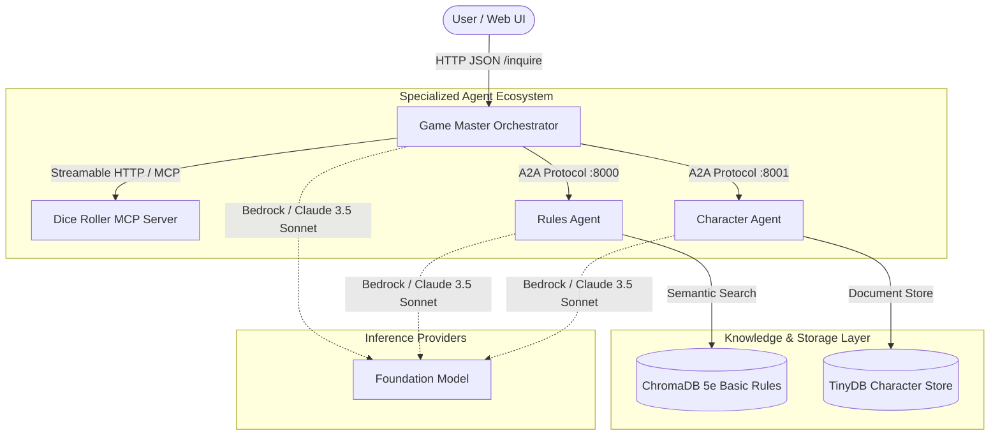

# Technical Context & Architecture: Once Upon Agentic AI

## 1. Executive Summary

**Once Upon Agentic AI** is an advanced, production-grade multi-agent role-playing game system powered by the **Strands Agents SDK**, **Model Context Protocol (MCP)**, **Agent-to-Agent (A2A) protocol**, and **Amazon Bedrock**.

The application orchestrates an autonomous **Game Master (GM)** that delegates specialized domain tasks to independent satellite micro-agents rather than attempting to solve every subproblem with a single monolithic prompt.



---

## 2. Core Protocols & Specifications

### 2.1 Model Context Protocol (MCP)
- **Role:** Provides dynamic, standardized tool discovery and execution across language barriers and process boundaries.
- **Implementation:** Built using `mcp.server.FastMCP` running over `streamable-http` on port `8002`.
- **Exposed Capability:**
  - `roll_dice(faces: int)`: Handles arbitrary die rolls (`d4`, `d6`, `d8`, `d10`, `d12`, `d20`, `d100`).
- **Client Binding:** Integrated into the Strands Agent via `MCPClient(url="http://localhost:8002/mcp")`.

### 2.2 Agent-to-Agent (A2A) Protocol
- **Role:** An open standard protocol designed for autonomous agents to communicate, advertise capabilities via agent cards, exchange conversational context, and invoke sub-agent trajectories.
- **Implementations:**
  1. **Rules Agent (`port 8000`):**
     - Exposes semantic search over the official D&D 5th Edition Basic Rules.
     - Automatically extracts page numbers and verbatim rules text to prevent hallucinated mechanics.
  2. **Character Agent (`port 8001`):**
     - Manages character lifecycle: creation (rolling 4d6 drop-lowest stats), persistent retrieval, and full party listings.
- **Client Tool:** Initialized via `make_a2a_client(allowed_endpoints=[...])` which discovers remote agent cards and dynamically injects them into the Game Master's tool loop.

### 2.3 Strands Agents SDK
- **Core Loop:** Orchestrates model invocation, reasoning delta streaming, structured output schema validation, tool resolution, and conversational state tracking.
- **Structured Output:** Strictly enforced using Pydantic `BaseModel` contracts (`StoryOutput` containing narrative, action suggestions, tool metadata, and structured dice roll records).

---

## 3. Data Architecture & Schemas

### 3.1 Pydantic Output Contracts

```python
class DiceOutput(BaseModel):
    dice_type: str = Field(description="The dice type, e.g. d4, d6, d20")
    result: int = Field(description="The numeric result of the roll")
    reason: str = Field(description="Reason for roll and any modifiers applied")

class StoryOutput(BaseModel):
    response: str = Field(description="Narrative response as Game Master")
    actions_suggestions: list[str] = Field(description="Suggested actions for the player")
    details: str = Field(description="Brief summary of tools/agents invoked")
    dice_rolls: list[DiceOutput] = Field(default=[], description="Structured dice rolls")
```

### 3.2 Character Record Schema

```json
{
  "character_id": "6ca1c390-e2b2-4d57-9d75-4c070c7b39a2",
  "name": "Thorin Ironbeard",
  "character_class": "Fighter",
  "race": "Dwarf",
  "gender": "Male",
  "level": 1,
  "experience": 0,
  "stats": {
    "strength": 16,
    "dexterity": 12,
    "constitution": 15,
    "intelligence": 10,
    "wisdom": 13,
    "charisma": 8
  },
  "inventory": [
    { "item_name": "Starting Equipment Pack", "quantity": 1 },
    { "item_name": "Gold Pieces", "quantity": 100 }
  ],
  "created_at": "2026-11-08T13:16:00.000000"
}
```

---

## 4. Execution Modes & Deployment Topology

| Topology | Target Environment | Components |
| :--- | :--- | :--- |
| **Microservices Mode** | Local Dev / Docker Compose | 4 independent processes: `dice_roll_mcp_server` (8002), `rules_agent` (8000), `character_agent` (8001), `gamemaster_orchestrator` (8009). |
| **Single-Container Mode** | Free Cloud (Render / Hugging Face Spaces) | `standalone_app.py` combining the Game Master and all specialized capabilities in-process, exposing port `$PORT`. |
| **Serverless MicroVMs** | AWS Bedrock AgentCore | Deployed via `agentcore` CLI: microVM runtimes with IAM SigV4 auth, Bedrock Knowledge Base RAG, and AgentCore Memory tables. |

