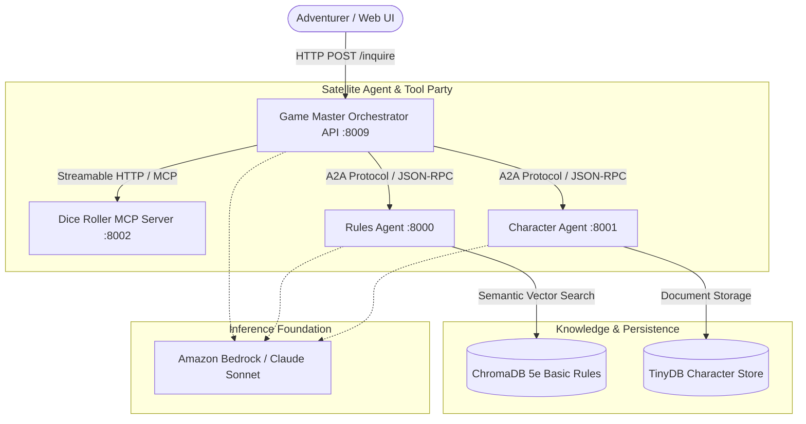

# 🧙‍♂️ Once Upon Agentic AI: Autonomous Fantasy Game Master

[](https://once-upon-agentic-ai.onrender.com)
[](https://www.python.org/)
[](https://strandsagents.com/)
[](https://modelcontextprotocol.io/)
[](https://a2a-protocol.org/)
[](https://fastapi.tiangolo.com/)

> *"Roll for Initiative... in Python!"* 🎲⚔️  
> 🌐 **Live Public App:** [https://once-upon-agentic-ai.onrender.com](https://once-upon-agentic-ai.onrender.com)  
> 📖 **Interactive Swagger Docs:** [https://once-upon-agentic-ai.onrender.com/docs](https://once-upon-agentic-ai.onrender.com/docs)

An advanced, production-grade **Multi-Agent RPG Game Master** platform built with the open-source **Strands Agents SDK**. The system moves beyond monolithic prompting by assembling a specialized party of autonomous AI agents communicating over **Model Context Protocol (MCP)** and **Agent-to-Agent (A2A)** protocol.

---

## 🏛️ System Architecture



---

## 🗺️ Project Modules & Chapter Walkthrough

| Module | Directory | Key Achievements |
| :--- | :--- | :--- |
| **Chapter 1: Agent Summoning** | [`1_strands_basics/`](1_strands_basics/) | Instantiated foundational `Agent` with fantasy Game Master persona; enabled debug logging for model tokens and reasoning inspection. |
| **Chapter 2: Vended Tools** | [`2_vended_tools/`](2_vended_tools/) | Registered `http_request` tool; agent autonomously queries the live Open5e REST API for spells (e.g. Fireball) and monster stats. |
| **Chapter 3: Custom Tool Forging** | [`3_custom_tools/`](3_custom_tools/) | Created `@tool roll_dice` supporting arbitrary faces; verified 4d6-drop-lowest ability score generation. |
| **Chapter 4: Planar Portals (MCP)** | [`4_mcp_integration/`](4_mcp_integration/) | Built a standalone `FastMCP` server with `streamable-http` transport on port `8002`; consumed dynamically via `MCPClient`. |
| **Chapter 5: The Grand Alliance (A2A)** | [`5_a2a_integration/`](5_a2a_integration/) | Built **Rules Agent** (ChromaDB RAG, port 8000) and **Character Agent** (TinyDB, port 8001); orchestrated by Game Master (port 8009) with Pydantic `StoryOutput`. |
| **Chapter 7: Strands Harness** | [`7_strands_harness/`](7_strands_harness/) | Unified agent construction with `create_harness` and standardized session management. |
| **Chapter 8: Production Readiness** | [`8_agentcore_production/`](8_agentcore_production/) | Authored IAM SigV4-signed MCP clients, A2A auth helpers, and AgentCore Memory integration. |
| **Free Cloud Deployment** | [`standalone_app.py`](standalone_app.py) | Self-contained, single-container production FastAPI service ready for free hosting on Render or Hugging Face. |

---

## 🚀 Quick Start (Local Development)

### 1. Prerequisites
Ensure you have Python 3.10+ and [`uv`](https://docs.astral.sh/uv/) installed:
```powershell
# Windows installer
irm https://astral.sh/uv/install.ps1 | iex
```

### 2. Install & Synchronize Dependencies
```bash
git clone https://github.com/<your-username>/once-upon-agentic-ai.git
cd once-upon-agentic-ai

# Installs Python and creates .venv with all dependencies
uv sync
```

Activate the virtual environment:
- **Windows:** `.venv\Scripts\activate`
- **macOS / Linux:** `source .venv/bin/activate`

### 3. Run the Standalone Game Master API
```bash
python standalone_app.py
```
The API starts on `http://localhost:8009`.

---

## 🌐 Deploy to Cloud for Free

### Option A: Render.com (Recommended for Backend)
1. Fork or push this repository to your GitHub account.
2. Sign in to [render.com](https://render.com) and create a **New Web Service**.
3. Select your repository and configure:
   - **Environment:** `Python 3`
   - **Build Command:** `pip install -r requirements.txt`
   - **Start Command:** `python standalone_app.py`
   - **Plan:** Free
4. Add your Environment Variables (AWS credentials or free Gemini/Groq model API key).
5. Deploy! Render will assign you a public HTTPS URL (e.g. `https://my-game-master.onrender.com`).

### Option B: Hugging Face Spaces
1. Create a new Space at [huggingface.co/spaces](https://huggingface.co/spaces) (choose Docker or FastAPI).
2. Push or connect this repository.
3. Hugging Face runs the agent service with 2 vCPUs and 16GB RAM for free.

### Option C: Frontend Web UI (GitHub Pages)
1. Navigate to your repository **Settings** → **Pages**.
2. Select **Deploy from a branch** and choose the `gh-pages` branch.
3. Open your deployed Web UI and point the API Endpoint to your Render backend URL.

---

## 📡 API Reference

### Health Check
```http
GET /health
```
```json
{
  "status": "healthy",
  "service": "game-master-api"
}
```

### Inquire (Game Master Turn)
```http
POST /inquire
Content-Type: application/json

{
  "question": "What are the rules for a dexterity check roll?"
}
```
**Response (Structured Output):**
```json
{
  "response": {
    "response": "The Rules Agent has spoken! Here are the rules for a Dexterity Check (Pages 61 & 63)...",
    "actions_suggestions": [
      "Make a Dexterity (Stealth) check to sneak past a guard",
      "Make a Dexterity (Acrobatics) check across a narrow ledge",
      "Ask about rules for another ability check"
    ],
    "details": "Queried the Rules Agent for dexterity check rules from official 5e rules.",
    "dice_rolls": []
  }
}
```

---

## 📂 Project Structure

```text
sample-once-upon-agentic-ai/
├── 1_strands_basics/          # Chapter 1: Foundational Agent & Debug Logging
├── 2_vended_tools/            # Chapter 2: Vended Tools (http_request, Open5e)
├── 3_custom_tools/            # Chapter 3: Custom @tool dice roller
├── 4_mcp_integration/         # Chapter 4: FastMCP server & MCP client
├── 5_a2a_integration/         # Chapter 5: Multi-agent A2A system
│   ├── agents/
│   │   ├── rules_agent/       # RAG agent over ChromaDB Basic Rules
│   │   ├── character_agent/   # Character sheets & TinyDB storage
│   │   └── gamemaster_orchestrator/ # FastAPI orchestrator
│   └── utils/                 # Knowledge base builder
├── 7_strands_harness/         # Chapter 7: Pre-assembled Strands Harness
├── 8_agentcore_production/    # Chapter 8: Bedrock AgentCore cloud setup
├── standalone_app.py          # Unified single-container production API
├── requirements.txt           # Standard cloud dependencies
├── CONTEXT.md                 # Technical architecture deep dive
├── PLAN.md                    # Roadmap & milestone presentation
└── README.md                  # Project documentation & guide
```

---

## 📜 License
This project is licensed under the MIT-0 License. See [LICENSE](LICENSE) for details.
